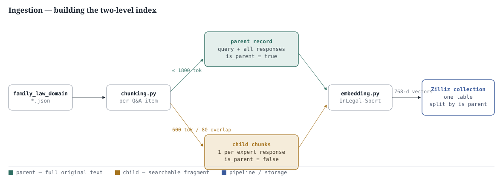
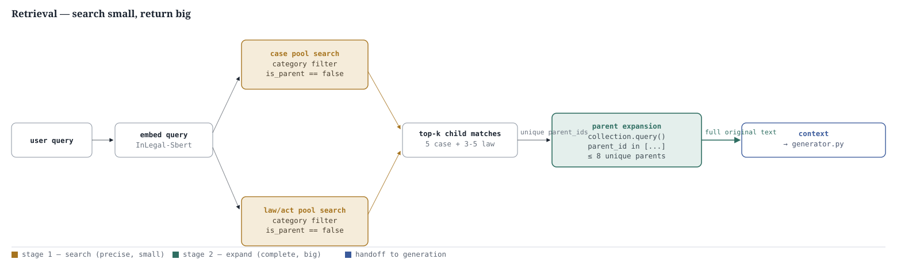
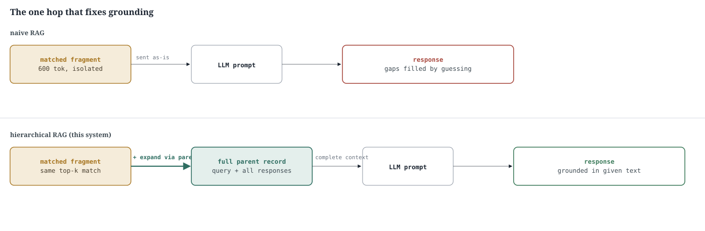

# Hierarchical RAG Architecture

How the retrieval layer was rebuilt around a parent–child index — precise vector search over fine-grained chunks, expanded to complete original context before anything reaches the model.

## Why this exists

The old pipeline chunked every expert response into independent 600-token pieces and searched them in isolation. A chunk could win the vector search yet contain only the middle of an argument — no antecedent, no cited section. The generator, faced with a gap, closed it itself: an invented citation, an assumed statute. The fix is structural: keep the fine-grained chunk for *search precision*, but hand the model the *complete* source document it came from ("small-to-big" retrieval).

## 1. Ingestion — building the two-level index

Both record types are embedded the same way and land in the **same** Zilliz collection — no second collection to keep in sync. A single boolean column, `is_parent`, is what turns one flat table into a two-level index.

## 2. Retrieval — search small, return big

Stage 1 never touches parent rows — `CHILD_ONLY_EXPR = "is_parent == false"` keeps the coarse parent embeddings out of top-k precision entirely. Stage 2 never re-ranks — it's a plain lookup by `parent_id`, capped at `MAX_EXPANDED_PARENTS = 8` so context size stays bounded even when several matched chunks share one parent.

## 3. The one hop that fixes grounding (naive vs. hierarchical)

Both lanes start from the identical vector match. Hierarchical retrieval adds exactly **one hop** — expansion by `parent_id` — before the model ever sees the text. That single hop is the entire mechanism behind the grounding improvement; nothing in the generation call itself changed except the prompt's explicit instruction not to fill gaps.

## Stage-by-stage, by file

| # | Stage | File | What it does |
|---|-------|------|---------------|
| 01 | Split & tag | `chunking.py` | Per item: write one parent record (query + all responses, ≤1800 tok, `is_parent: true`), then chunk each response into 600-tok/80-overlap child records (`is_parent: false`). Both share the item's index as `parent_id`. |
| 02 | Embed | `embedding.py` | Every record — parent or child — encoded the same way with `bhavyagiri/InLegal-Sbert` (768-d), framed as `Query: … Answer: …`. Parent embeddings are coarse by construction (encoder truncates); fine, since parents are never searched directly. |
| 03 | Store | `milvus_store.py` | One Zilliz collection holds both record types. Only schema addition over the naive version: one `BOOL` column, `is_parent`. |
| 04 | Search children | `nodes/retriever.py` | `_search()` runs against `is_parent == false` only, split into case-law pool and law/act pool by category filter, each with its own top-k. |
| 05 | Expand to parents | `nodes/retriever.py` | `_expand_to_parents()` keeps the best child per unique `parent_id`, fetches full parent text with one `collection.query(is_parent == true and parent_id in […])` call, capped at 8. |
| 06 | Generate, grounded | `nodes/generator.py` | `format_context()` presents each expanded parent as a complete case; system prompt states explicit grounding rules — cite only what's in context, say so plainly when context doesn't cover something. |

## Key parameters

| Parameter | Value | Set in |
|---|---|---|
| Child chunk size / overlap | 600 tok / 80 tok | `chunking.py` |
| Parent record cap | 1,800 tok | `chunking.py` |
| Embedding model / dim | `bhavyagiri/InLegal-Sbert` · 768-d | `.env` |
| Case-pool top-k | 5 | `retrieval_cases_top_k` |
| Law/act-pool top-k | 3 (or 5 if context ≥ 16k) | `retrieval_laws_top_k` |
| Max expanded parents / query | 8 | `retriever.py` |
| Parent/child flag | `is_parent : BOOL` | Zilliz schema |
